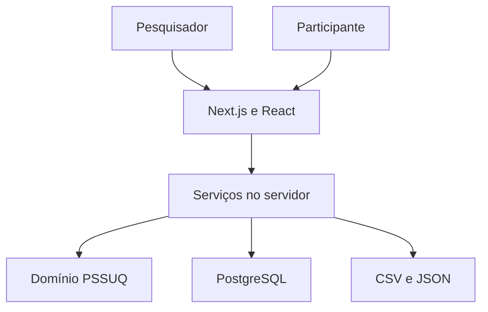

**PONTIFÍCIA UNIVERSIDADE CATÓLICA DO PARANÁ** 
PPGIa — Programa de Pós-Graduação em Informática 
Mestrado · 2026/02

# Arquitetura e contratos

**Equipe:** [integrantes e contatos institucionais](../README.md#equipe).

## Fluxo e fronteiras

A UI nunca envia um escore confiável: o servidor valida as respostas e calcula. O módulo de domínio é puro e reutilizado em análise/exportação. Consultas ao banco ficam no servidor. Não enviar DATABASE_URL ao navegador.

## Estados de estudo e sessão

Estudo: DRAFT → OPEN → CLOSED → ARCHIVED. Editar configuração somente em DRAFT. Encerrar não apaga respostas. Correção de tarefas ou idioma após abertura exige novo estudo ou nova rodada separada.

Sessão: CREATED → TASKS_FINISHED → SUBMITTED. TASKS_FINISHED registra término das tentativas, não sucesso de todas as tarefas. Uma sessão sem tarefas concluídas/encerradas não recebe formulário. O pesquisador documenta como verificou o uso do sistema.

Snapshot do instrumento: id, versão, idioma, 16 textos, instruções, rótulos dos extremos, fonte, hash e revisão. A base não inclui textos completos; não inserir snapshot fictício como canônico. O campo protocol_reviewed_at fica nulo até a revisão. Abrir estudo deve exigir esse campo e o catálogo íntegro.

## Endpoints a implementar no MVP

| Rota proposta | Autorização | Contrato resumido |
|---|---|---|
| GET/POST /api/studies | Pesquisador autenticado | Listar próprios estudos / criar rascunho |
| GET/PATCH /api/studies/[id] | Proprietário | Ler/editar; transições explícitas; impedir edição do protocolo aberto |
| POST /api/studies/[id]/sessions | Estudo OPEN | Criar token aleatório; devolver token só na criação |
| POST /api/sessions/[token]/tasks-finished | Token válido + estudo OPEN | Registrar término da sessão de uso |
| POST /api/sessions/[token]/responses | Token + tarefas finalizadas + estudo OPEN | 16 posições; validar; transação; envio idempotente |
| GET /api/studies/[id]/results | Proprietário | Médias individuais/agregadas, cobertura, versão |
| GET /api/studies/[id]/export?format=csv | Proprietário | Respostas + metadados + escores |
| GET /api/studies/[id]/export?format=json | Proprietário | Estrutura reprodutível com estados explícitos |

Não há endpoints de coleta implementados nesta base. Login/autorização devem preceder a exposição da área de gestão. Uma URL com UUID não substitui autorização.

## Transação de submissão

1. Validar tamanho e conteúdo das respostas no servidor.
2. Iniciar transação e bloquear a sessão para evitar envios simultâneos.
3. Verificar hash do token, estudo aberto, protocolo revisado, tarefas encerradas e estado atual.
4. Se já submetida, devolver confirmação estável, sem novo INSERT.
5. Inserir os 16 estados/respostas e marcar sessão SUBMITTED na mesma transação.
6. Confirmar commit; em erro, rollback. Nunca manter conjunto parcial como submissão válida.

A validação de cardinalidade, propriedade e transições está no serviço a implementar; o schema sozinho não implementa o fluxo. Testar fechamento do estudo concorrente com envio antes de considerar a coleta pronta.

## Exportação

Formato tabular proposto: study_id, session_id, instrument_version, language, snapshot_sha256, scoring_version, submitted_at, q01…q16, overall, sysuse, infoqual, intqual e contagens por fator. Não exportar token, hash de autenticação, senha ou identificadores pessoais.

Separador CSV explícito e documentado; usar aspas corretamente em células com delimitador, aspas ou quebra de linha. Tratar conteúdo textual iniciado por sinais interpretáveis como fórmula em planilhas. Oferecer JSON sem ambiguidade entre número, NA e ausência.

## Decisões registradas

- ADR-01: um instrumento e uma versão no MVP para reduzir risco metodológico.
- ADR-02: SQL + pg; nenhuma necessidade de microserviços.
- ADR-03: médias derivadas das respostas brutas; algoritmo versionado.
- ADR-04: revisão do idioma e texto como condição de abertura.
- ADR-05: GitHub para código; demonstração local viável; publicação web separada.
